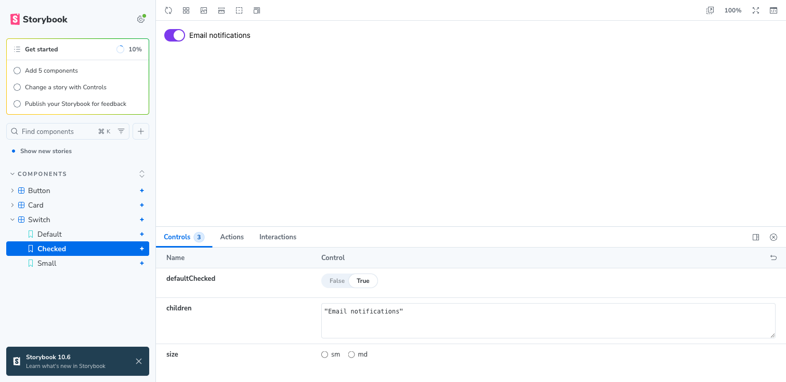

# panda-ds-starter

A design system monorepo built with [Panda CSS](https://v2.panda-css.com), [Ark UI](https://ark-ui.com), and
Storybook. One set of tokens and recipes powers React and Vue components. Edit a token, a recipe, or a
component and every app updates without a restart.



```
packages/
  tokens/            raw values (colors, radii), no Panda, works anywhere JS runs
  preset/            turns tokens into a Panda preset, plus recipes
  react/             React components (plain + Ark UI) and stories
  vue/               Vue components (plain + Ark UI) and stories
apps/
  storybook-react/   Storybook for @ds/react     → localhost:6006
  storybook-vue/     Storybook for @ds/vue       → localhost:6007
```

Tooling: [bun](https://bun.sh) workspaces, [Turborepo](https://turborepo.com),
[oxlint](https://oxc.rs/docs/guide/usage/linter) and [oxfmt](https://oxc.rs/docs/guide/usage/formatter).

## Get started

```bash
bun install
bun dev
```

| Script                                           | What it does                                                        |
| ------------------------------------------------ | ------------------------------------------------------------------- |
| `bun dev`                                        | Builds each component package once, then watches it next to its app |
| `bunx turbo dev --filter=@ds/storybook-react...` | Only React: Storybook plus the packages it depends on               |
| `bun run build`                                  | `panda lib` for every component package, then builds every app      |
| `bun run lint`                                   | oxlint                                                              |
| `bun run format`                                 | oxfmt                                                               |

## How the apps get their CSS

Each component package (`react`, `vue`) is a Panda design system. It owns a `panda.config.ts` built on the
shared preset and runs `panda lib`, which writes a small manifest to `dist/panda/` listing every style its components
use.

Each app points at one package with `designSystem`, and the `@pandacss/vite` plugin turns that manifest into CSS.
Nothing is imported by hand except the layer order in a CSS file.

```ts
// apps/storybook-react/panda.config.ts
export default defineConfig({
  designSystem: '@ds/react',
  include: ['.storybook/**/*.{ts,tsx}'],
  staticCss: { recipes: '*' },
})
```

```
tokens ──▶ preset ──┬──▶ react (panda lib --watch) ──▶ storybook-react
                    └──▶ vue   (panda lib --watch) ──▶ storybook-vue
```

Storybook consumes the design system the same way a real app would. If it looks right there, it looks right in your
apps.

## What updates live

- **Tokens**: edit `packages/tokens/src/index.ts`. Every `panda lib --watch` follows the preset's imports and rebuilds.
- **Recipes**: edit anything in `packages/preset/src/recipes/`.
- **Components and stories**: edit `packages/{react,vue}/src/`.

There's no build step for `tokens` and `preset`. Their `package.json` exports point at `src/index.ts`, so saving the file
is the whole update.

## Add an Ark UI component

`Switch` is the template, in [React](packages/react/src/switch/switch.tsx) and [Vue](packages/vue/src/switch/Switch.vue).

1. Write a slot recipe in the preset, one slot per Ark part. Ark sets `data-state="checked"`, `data-disabled` and so on,
   and Panda's `_checked` and `_disabled` conditions already match those.

   ```ts
   // packages/preset/src/recipes/switch.ts
   export const switchRecipe = defineSlotRecipe({
     className: 'switch',
     slots: ['root', 'control', 'thumb', 'label'],
     base: {
       control: { bg: 'gray.300', _checked: { bg: 'brand.600' } },
       // ...
     },
   })
   ```

   Register it under `slotRecipes` in `packages/preset/src/index.ts`. Every framework package picks it up.

2. In the component, pass each slot's class to the matching Ark part:

   ```tsx
   // packages/react/src/switch/switch.tsx
   const classes = switchRecipe({ size })

   <ArkSwitch.Root className={classes.root} {...props}>
     <ArkSwitch.Control className={classes.control}>
       <ArkSwitch.Thumb className={classes.thumb} />
     </ArkSwitch.Control>
     <ArkSwitch.Label className={classes.label}>{children}</ArkSwitch.Label>
     <ArkSwitch.HiddenInput />
   </ArkSwitch.Root>
   ```

   The Vue version is the same shape with `@ark-ui/vue` and `:class`.

Slot names come from each component's anatomy (`switchAnatomy.keys()` from `@ark-ui/react/switch`). They're written out
by hand here so the preset doesn't depend on a framework.

## Use it in your own app

```ts
// panda.config.ts in your app
export default defineConfig({
  designSystem: '@ds/react',
  include: ['src/**/*.{ts,tsx}'],
  jsxFramework: 'react',
})
```

Set `jsxFramework`. Panda only tracks `<Button size="lg">` back to the `button` recipe when it is set. Without it you get
the default variant only.

Don't copy `staticCss: { recipes: '*' }` into an app. It's there so Storybook controls render every variant. In an app it
ships CSS for variants nobody uses.

## Make it yours

- Rename the `@ds/` scope with a find and replace, including the `server.watch` lines in the Vite configs.
- `@pandacss/preset-panda` gives you Panda's default spacing, sizes, and palette. Drop it from the component packages'
  `panda.config.ts` if your tokens should be the only ones. Then define spacing yourself, or `h: '10'` becomes `10px`.
- Only need React? Delete `packages/vue` and `apps/storybook-vue`.

## Gotchas

- **`bunfig.toml` uses the hoisted linker.** With bun's isolated installs, apps can't resolve `@pandacss/preset-base`
  through the design system.
- **Don't name a workspace package `storybook`.** It shadows the real `storybook` package.
- **Don't add a design system to `include`.** `designSystem` already covers it.
- **`design_system_export_missing … "./jsx"` in the Vue logs** is a false alarm in `@pandacss/*@2.1.1`. The
  build still succeeds, and the next release fixes it.

## Learn more

- [Build a design system](https://v2.panda-css.com/docs/design-systems/build-a-design-system)
- [Monorepo workflow](https://v2.panda-css.com/docs/design-systems/monorepo-workflow)
- [Storybook](https://v2.panda-css.com/docs/design-systems/storybook)
- [Config recipes: JSX name](https://v2.panda-css.com/docs/recipes/config-recipe#jsx-name)
- [Ark UI styling guide](https://ark-ui.com/docs/guides/styling)
